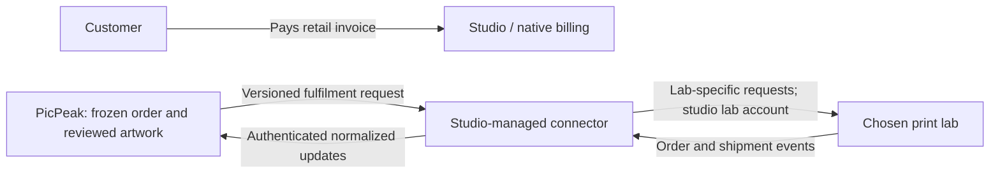

# Print labs: manual setup and optional API connections

Research checked on **29 October 2026**. WHCC and Prodigi are comparison examples,
not preferred labs or included integrations. This follows the
[maintainer's supplier-neutral scope](https://github.com/PicPeak/picpeak/issues/48#issuecomment-6402523874).

**Implemented:** configurable manufacturing profiles, supplier labels/codes/notes,
native customer invoices, prepared artwork, supplier packs and reviewed manual
submission. **Proposed:** a Print Labs settings area with Manual and API connection
sections, a lab registry and a generic connector contract. There is currently no
connector endpoint, API credential field, public artwork link or automatic lab
purchase in this branch. The API setup below is a development guide; it cannot
be enabled by entering a lab API key today.

## Payments and lab selection today

Acceptance creates one native CRM invoice using shared-catalogue retail prices,
delivery and VAT. The studio issues/sends it through normal billing. Bank transfer
and payments confirmed in the native ledger settle it. The print shop has no
Stripe/card checkout. Payment and rendering can complete in either order;
supplier downloads, studio review and submission require the exact invoice to be
fully settled and production files to pass identity checks. Partial payment does
not release an order. See [the workflow](print-sales.md).

The studio chooses a supplier when configuring each profile's label, production
code, measurements, file requirements and instructions. These values are frozen
with the order. They are not a lab directory or routing engine. The buyer chooses
configured products/options; there is no independent buyer lab selector.

The current order has one manual submission reference and one dispatch record.
Several supplier labels can appear in its pack, but there is no per-lab purchase,
partial dispatch or automatic split-shipment tracking. Mixed-lab orders require
manual coordination. Do not treat those labels as API routing configuration.

The customer pays the studio; the studio separately pays its lab for production,
shipping and supplier taxes. Lab acceptance/billing does not settle the customer
invoice. Customer settlement does not prove lab payment or acceptance. Supplier
cost quotes must not replace frozen retail totals or silently increase an
accepted invoice. Refunds and lab cancellation also need separate confirmation.

## Manual Print Lab section

This is the working fulfilment path. A separate section can group the existing
supplier fields and manufacturing profiles without introducing another catalogue.

1. Check the supplier's exact product specification and ordering method. A
   portal, desktop application or accepted file import can work without an API.
2. Add products/options to the shared catalogue and connect retail CRM prices.
   In Settings → Print sales, record the supplier label, production code and
   ordering instructions on each supported manufacturing variant.
3. Enter actual trim, bleed, safe area, resolution, crop/fit, file encoding and
   accepted RGB profile. Verify the template and any lab colour-correction
   setting. Generic size/bleed helpers are starting values; enable after review.
   See [the production research](print-sales-market-research.md).
4. Configure delivery countries/zones and retail shipping. Confirm the supplier
   can deliver each offered product there.
5. Check synthetic crops, borders, filenames and quantities in the ZIP, manifest
   and private studio PDF. Validate colour and edge loss with physical samples
   before opening the product to customers.
6. Once settled and ready, download/check the exact files, record studio review
   and place the order in the lab's system. Send only material the lab needs;
   the private PDF includes customer details.
7. Record the lab reference, then dispatch/tracking. These records do not send
   files, purchase prints or confirm supplier payment.

A future registry should give each studio-defined lab a stable ID, name,
instructions and linked profiles. It should accept any lab and retain accepted
order identities when a lab is renamed or disabled.

## API-compatible section: proposed boundary

Feasible, with a **studio-managed connector** between PicPeak and the lab. APIs
commonly cover products/options, artwork, quotes, shipping, submission and status.
That is a shared domain, not a universal protocol: authentication, identifiers,
construction steps, image handling and event semantics vary.

PicPeak would maintain its versioned interface, release checks and order history.
The studio or a community connector maintainer would own provider authentication,
catalogue mappings, API upgrades and support. A setup guide and conformance
fixtures reduce that work; they do not eliminate it. Avoid arbitrary JavaScript
or unrestricted HTTP request templates in settings.

Settings should expose a connection label, test/live mode, secret reference,
capabilities and connection/test status. Provider credentials belong in the
connector's server-side secret store. A generic PicPeak connection secret is
separate from a lab key. Keep manual fulfilment available and make API release
an explicit studio action initially.

### Minimum contract for a later implementation

These are proposed requirements, not existing routes or payload schemas.

| Boundary | Required behaviour |
|---|---|
| Connection | Negotiate contract version, test/live mode, file/product capabilities, address requirements and status/cancellation support. Refuse unsupported combinations. |
| Mapping | Map exact catalogue choices and profile revision to lab product/options and shipping service. Freeze mapping identity with release; names are insufficient identifiers. |
| Cost check | Return supplier cost, currency, shipping, tax and estimate/expiry limitations. Studio approval is separate from customer retail prices. |
| Release | Bind approval to order/snapshot hash, artwork version, stable lines/quantities, connection, mapping, address and cost check. Require settlement and current studio review. |
| Artwork | Scope access to reviewed production files with SHA-256, size, media type and geometry. Use expiring URLs or authenticated streams; expose neither originals nor storage directories. Support delayed download/expiry recovery. |
| Submission | Persist an idempotency key/request identity before network access. Distinguish queued, accepted, rejected and uncertain results; save all external IDs. HTTP success alone is not production acceptance. |
| Updates | Authenticate connector callbacks, validate order/connection binding, deduplicate events and retain item/shipment allocations. Keep raw provider status for diagnosis; never derive customer payment state from lab events. |
| Recovery | Bound retries and reconcile timeouts. Never create a new purchase or manually reorder while a previous submission may exist. Preserve history when disabling a connection. |
| Cancellation | Confirm lab cancellation separately from native invoice correction/refund; report refusal when production is too far advanced. |

Initially, route a release to one lab. Reject mixed connections before purchase
until per-lab groups, partial failure, shipping charges and shipment history
exist. One lab can itself create several external orders/parcels, so the first
API slice still needs a one-to-many external-order/shipment model. Retain existing
accepted profiles as manual work; routing must not reinterpret accepted orders.

## WHCC and Prodigi comparison

### WHCC

WHCC directs new integrations to its newer WHCC API. The older Editor and Order
Submit APIs remain for existing integrations; do not mix their token/import/
confirm examples with the new API-key flow.
[Documentation overview](https://www.whcc.com/developer/docs/).

| Topic | Current documented behaviour | Connector implication |
|---|---|---|
| Authentication/version | Account-bound bearer API key; separate sandbox/live hosts and keys; version header `WHCC-API-Version: 2026-10`. | Bind mode, host and key; pin the version. |
| Products | Filter catalogue entries on `completion: "api"`; editor-only products need design completion. Build configured products and await readiness. | Map exact choices; do not advertise unsupported compound products. |
| Artwork | Fetchable JPEG/HEIC/PNG under 100 MB, including signed URLs; caller must check resolution. | Use reviewed JPEG/PNG; refuse TIFF on this path. Keep PicPeak's resolution checks. |
| Pricing/shipping | Calculate before submission; shipping depends on the address. Calculation does not reserve final price. International delivery can need a phone. | Recheck cost/service and required fields. PicPeak's current delivery form has no phone field. |
| Release | Required idempotency header; asynchronous submission can produce several orders/fulfilment orders and partial failure. | Persist and reconcile every external identity. Never resubmit the whole basket to recover failed lines. |
| Events | Signed, account-level event subscriptions need setup and enabling. | Verify raw-body HMAC; handle duplicates and split shipments. |

Sources: [API reference](https://www.whcc.com/developer/docs/api/),
[quick start](https://www.whcc.com/developer/docs/quick-start/),
[versions](https://www.whcc.com/developer/docs/api/versioning/),
[shipping](https://www.whcc.com/developer/docs/api/shipping/),
[submission lifecycle](https://www.whcc.com/developer/docs/api/submission-lifecycle/),
[events](https://www.whcc.com/developer/docs/api/event-subscriptions/).

### Prodigi

The [v5 reference](https://www.prodigi.com/print-api/reference/v5) loads a public
[OpenAPI 3.1 specification](https://www.prodigi.com/print-api/reference/openapi.yml),
labelled API version `5.0.0`. These findings are from that specification, not an
authenticated account test.

| Topic | v5 specification | Connector implication |
|---|---|---|
| Authentication/mode | `X-API-Key`; `sandbox_`/`live_` keys select mode on `https://api.prodigi.com/v5`. Some non-order resources share live account services. | Sandbox order tests must avoid changing shared settings, channels or saved products. |
| Products/artwork | Order writes require catalogue SKUs and artwork URLs. Managed asset IDs and saved product-variant IDs are not resolved there. Separate upload/ingest endpoints exist. | Map SKUs/print areas explicitly; uploading artwork does not make its ID valid in an order. |
| Quote/release | `/quotes/order` estimates costs; draft and separate submission are supported. Creation is asynchronous. | Prefer draft, validation and explicit release; acknowledgement is not completed production acceptance. |
| Retry safety | Creation supports `Idempotency-Key`; most other operations do not act on it yet, according to the introduction. | A listed header parameter does not guarantee an operation is idempotent. Reconcile before retrying submission. |
| Events | `/webhooks` and test ping are specified with `X-Prodigi-Signature` raw-body HMAC. Per-order `callbackUrl` uses v4 format. | Select and test one event contract rather than treating the formats as identical. |
| Limits | 1,000 requests/hour/key with rate-limit headers and `Retry-After`. | Bound reconciliation and respect backoff. |

The [FAQ](https://www.prodigi.com/faq/print-api/) describes v5 but says webhook
subscriptions are unavailable, conflicting with the specification. The older
[v4 reference](https://www.prodigi.com/print-api/docs/reference/) still calls v4
current, uses separate sandbox/live hosts, JSON `idempotencyKey` and CloudEvents
callbacks. Its paused-order visibility differs from v5. Confirm the chosen API
version and webhook support during setup; do not combine generations. The FAQ's
v5 launch/migration blog links returned 404 during this review.

Prodigi's [pricing explanation](https://www.prodigi.com/faq/payments-and-pricing/)
separates merchant retail sales from supplier charges. Its
[payment timing guidance](https://support.prodigi.com/hc/en-us/articles/18964132086044-When-do-you-take-payment-for-an-order)
ties charging to production/account billing arrangements. This is the studio's
supplier account, not customer checkout in PicPeak.

## Studio connector setup guide

After a generic harness and conforming connector exist:

1. Choose a connector maintainer and supported API version. Confirm products,
   destinations, production origin, billing and cancellation with the lab. A
   network's geographic coverage does not guarantee a particular dispatch country.
2. Deploy the connector separately and obtain credentials through the lab's
   account process. Set mode explicitly and configure the generic connection
   secret. Exclude secrets/customer details from source, browser code and logs.
3. Map verified profile revisions to exact products/options, print areas and
   shipping services. Reject unknown mappings/unsupported formats or colour.
   Check that lab processing preserves the approved crop, borders and colour.
4. Test secure artwork delivery without a PicPeak login: return actual file
   bytes, verify identity and recover delayed downloads/expired URLs without
   replacing approved artwork.
5. Register/test events. Verify signatures/binding; test duplicates, reordered
   events, several parcels, missed events and reconciliation. The connector
   authenticates provider events; PicPeak authenticates normalized updates.
6. Test quote, draft and release with synthetic data: unknown SKU, wrong
   address/country, lab payment failure, expired URL, timeout after creation,
   repeated release, partial acceptance and cancellation refusal. Confirm tests
   neither order live prints nor modify shared live account resources.
7. Keep automatic submission off. A studio-approved live sample is a separate,
   billable purchase. Inspect its physical result and tracking before opening
   normal orders; recheck after connector/product changes.

## Proposed PR sequence

1. Review the existing invoice/manual-export implementation and this lab guide.
2. Add Manual/API settings organisation and stable lab/profile associations,
   preserving accepted orders and manual fulfilment.
3. Agree/implement the generic harness with a fake connector, conformance tests,
   scoped artwork access, explicit release and reconciliation.
4. Publish separately maintained WHCC/Prodigi mapping examples and sandbox results
   when there is a connector owner. Keep provider-specific code out of core.

This review used public documentation only. No lab accounts, keys, orders,
payments or subscriptions were created. Directory lookup was attempted but its
CLI endpoint rejected the request; findings use official provider documentation.
